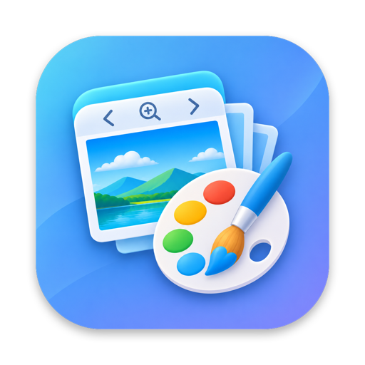
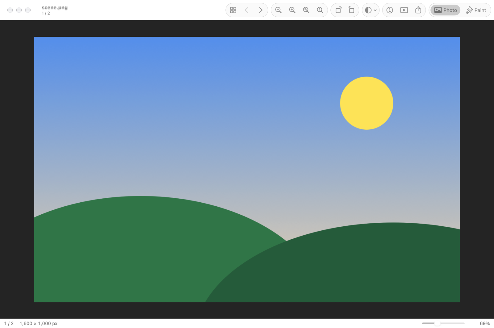
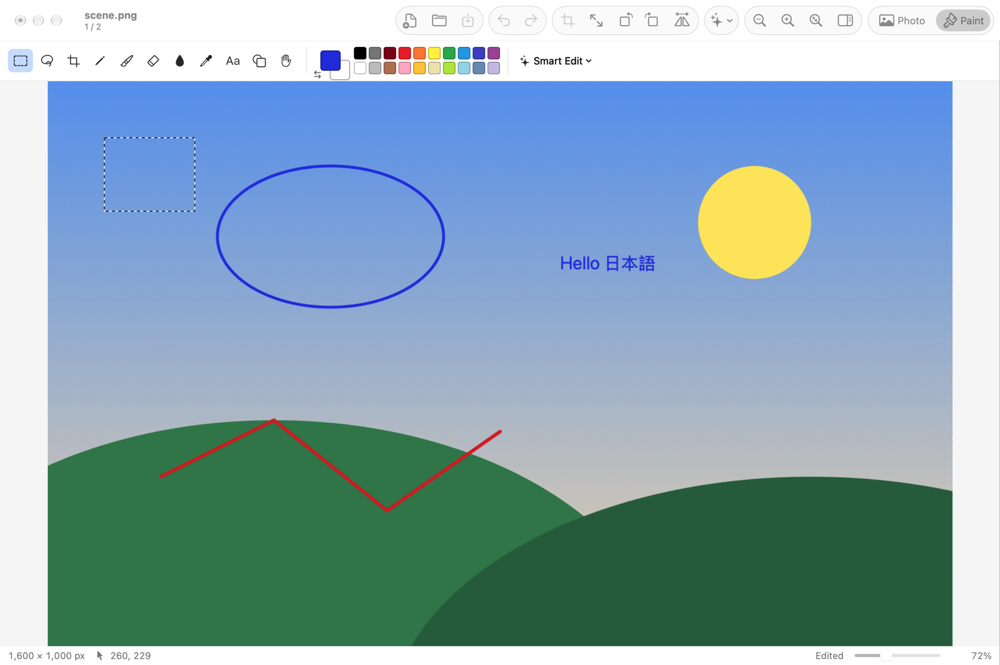
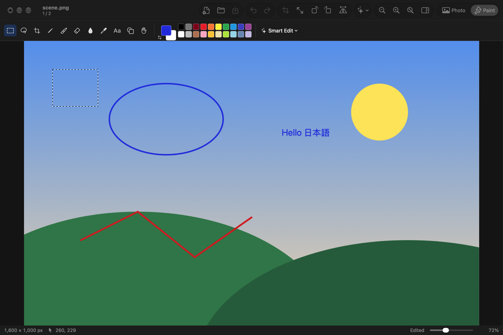

<p align="center">
  
</p>

<h1 align="center">DosPhotoPaint</h1>

<p align="center">
  A lightweight native macOS image viewer and paint app — one window, two modes.<br>
  軽量なネイティブ macOS 画像ビューア兼ペイントアプリ — 1つのウィンドウに2つのモード。
</p>

<p align="center">
  <a href="#english">English</a> · <a href="#日本語">日本語</a> · <a href="LICENSE">MIT License</a>
</p>

| Photo mode | Paint mode | Paint (dark) |
|---|---|---|
|  |  |  |

---

## English

DosPhotoPaint combines a fast photo viewer with a simple, Windows Paint–style editor. Switch between
**Photo** (browse) and **Paint** (edit) in the same window with `⌘E`; the image, zoom, edits and undo
history are kept. Swift 6 / AppKit + SwiftUI, no third-party dependencies, no network access.
On first launch the app offers to open System Settings for **Full Disk Access** (optional): with it, macOS never asks before images on the Desktop, in Documents, Downloads or on network / external drives are opened.

### Features

**Photo mode**
- Browse every image in the folder with ← / →, Home / End; sort by name, natural name or date
- Image browser (`⌘B`): tiles or list of the folder, optionally including subfolders; thumbnail size on the status bar slider
- Animated GIF / APNG / WebP playback that always loops, with a frame strip (step, pause, jump to a frame)
- Background colour (white / black / light grey / dark grey) from the toolbar
- Full-screen slideshow (interval, loop, shuffle, dissolve) with no toolbars in the way
- Zoom (fit, width, height, 100 %, actual pixels, slider), rotate, image info, compare with original, share, drag out

**Paint mode**
- Tools: rectangle / free-form select, crop, pen, brush, eraser, fill, eyedropper, text, shapes, hand
- Tool ribbon above the canvas with a 20-colour quick palette (or a vertical palette on the left — your choice)
- Layers (opacity, visibility, reorder, merge, flatten), selections with move / scale / rotate, clipboard
- Resize image, canvas size, rotate / flip, crop to selection, unlimited-ish undo (configurable)
- **Smart Edit** (on-device macOS frameworks): Remove Background, Copy Subject to New Layer (Vision), Auto Enhance (Core Image)

**Files**: PNG, JPEG, HEIC/HEIF, TIFF, BMP, GIF, WebP (read); `.dpp` project files keep layers.
Japanese and English UI, light and dark appearance.

### Install

1. Download `DosPhotoPaint-<version>.dmg` from [Releases](../../releases).
2. Open it and drag **DosPhotoPaint** to **Applications**.

Requires macOS 15 or later (Apple silicon tested; Universal binary).

### Build from source

```sh
brew install xcodegen          # once
xcodegen generate              # creates DosPhotoPaint.xcodeproj from project.yml
xcodebuild -project DosPhotoPaint.xcodeproj -scheme DosPhotoPaint -configuration Release build
xcodebuild -project DosPhotoPaint.xcodeproj -scheme DosPhotoPaint test
```

Edit `project.yml`, not the generated project. Localizations live in `tools/l10n_ja/*.json` and are merged
into the String Catalogs with `tools/l10n_sync.py`.

### License

[MIT](LICENSE)

### Documentation (Japanese)

[Features](docs/FEATURES.md) · [File formats](docs/FILE_FORMATS.md) · [Shortcuts](docs/SHORTCUTS.md) ·
[Settings](docs/SETTINGS.md) · [Known issues](docs/KNOWN_ISSUES.md) · [Test results](docs/TEST_RESULTS.md) ·
[Architecture (English)](docs/ARCHITECTURE.md) · [Performance (English)](docs/PERFORMANCE.md)

---

## 日本語

DosPhotoPaint は、高速な写真ビューアと Windows ペイント風のシンプルな編集機能をひとつにした macOS
アプリです。同じウィンドウで **Photo**(閲覧)と **Paint**(編集)を `⌘E` で切り替えられ、画像・ズーム・
編集内容・アンドゥ履歴はそのまま保持されます。Swift 6 / AppKit + SwiftUI、サードパーティ依存なし、
ネットワーク通信なし。
初回起動時に **フルディスクアクセス** の設定画面を開くか確認します(任意)。許可するとデスクトップ・書類・ダウンロード・ネットワーク/外部ドライブの画像を開くときに macOS の確認が出なくなります。

### 主な機能

**Photo モード**
- 同じフォルダの画像を ← / →、Home / End で閲覧。名前・自然順・日付で並べ替え
- 画像一覧(`⌘B`): フォルダの画像をタイル/リストで表示、サブフォルダも対象にできる。サムネイルの大きさはステータスバーのスライダーで調整
- アニメーション GIF / APNG / WebP を常にループ再生。下部にコマ一覧(コマ送り・一時停止・任意のコマへ移動)
- 背景色(白・黒・薄いグレー・濃いグレー)をツールバーから切替
- 全画面スライドショー(間隔・ループ・シャッフル・ディゾルブ)。再生中はツールバー等を隠す
- ズーム(フィット・幅・高さ・100%・実ピクセル・スライダー)、回転、画像情報、元画像と比較、共有、ドラッグで書き出し

**Paint モード**
- ツール: 矩形/自由選択、切り抜き、ペン、ブラシ、消しゴム、塗りつぶし、スポイト、テキスト、図形、手のひら
- キャンバス上部のツールリボン(基本色 20 色パレット付き)。設定で左側の縦パレットにも変更可
- レイヤー(不透明度・表示・並べ替え・結合・統合)、選択範囲の移動・拡大縮小・回転、クリップボード
- 画像サイズ変更、キャンバスサイズ、回転・反転、選択範囲で切り抜き、アンドゥ段数は設定可
- **AI 編集**(macOS 標準のオンデバイス処理): 背景を削除、被写体を新規レイヤーにコピー(Vision)、自動補正(Core Image)

**ファイル**: PNG・JPEG・HEIC/HEIF・TIFF・BMP・GIF・WebP の読み込み、レイヤーを保持する `.dpp` プロジェクト。
日本語 / 英語 UI、ライト / ダーク対応。

### インストール

1. [Releases](../../releases) から `DosPhotoPaint-<バージョン>.dmg` をダウンロード
2. 開いて **DosPhotoPaint** を **アプリケーション** フォルダへドラッグ

macOS 15 以降(Apple シリコンで動作確認、Universal バイナリ)。

### ソースからビルド

```sh
brew install xcodegen          # 初回のみ
xcodegen generate              # project.yml から DosPhotoPaint.xcodeproj を生成
xcodebuild -project DosPhotoPaint.xcodeproj -scheme DosPhotoPaint -configuration Release build
xcodebuild -project DosPhotoPaint.xcodeproj -scheme DosPhotoPaint test
```

`.xcodeproj` は手で編集せず `project.yml` を編集してください。訳文は `tools/l10n_ja/*.json` にあり、
`tools/l10n_sync.py` で String Catalog に反映します。

### ライセンス

[MIT](LICENSE)

### ドキュメント

[機能一覧](docs/FEATURES.md) · [対応形式](docs/FILE_FORMATS.md) · [ショートカット](docs/SHORTCUTS.md) ·
[設定](docs/SETTINGS.md) · [既知の制約](docs/KNOWN_ISSUES.md) · [テスト結果](docs/TEST_RESULTS.md) ·
[設計(英語)](docs/ARCHITECTURE.md) · [性能(英語)](docs/PERFORMANCE.md)
